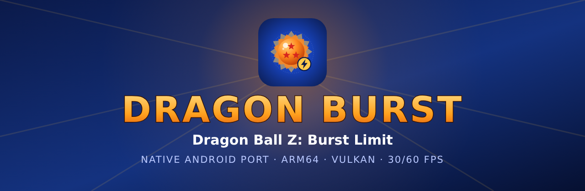

<p align="center"></p>

# Dragon Burst

[Português](README.md) · **English** · [Español](README.es.md)

Native Android port of **[DBZ Burst Limit Recompiled](https://github.com/iExplosiveRage/DBZ-Burst-Limit-Recompiled)**
(iExplosiveRage), the static recompilation of Dragon Ball Z: Burst Limit for Xbox 360. The game code runs
natively on arm64 (it is not emulated), on the ReXGlue SDK runtime with Vulkan and the Dragon Fury base
(the Android port of DBZ Budokai 3 HD).

> **No game files included.** You need your own legal copy, **USA (NTSC-U)** version.
>
> **Version 0.1.0, the first one.** Tested on the Retroid Pocket 5 and the Anbernic RG Cube. Anything not
> tested on a device yet is marked **experimental**.

## Features

**Launcher**
- Import the game straight from the `.iso` or from an extracted folder (`default.xex` + `LONG2DATA/`).
  USA only: the app checks the executable and tells you if the disc is another game, another region,
  modified or truncated. **Verify files** checks the install later.
- Tabs: Home, Performance, Controls, Game, Mods, Textures, Drivers, Debug, Settings and About. Its own
  theme, Portuguese, English and Spanish, home screen shortcut.
- **Auto-update**: on launch the app looks for a new version in the GitHub Releases, shows what changed
  (in the app's language), downloads the APK and opens the installer.

**Game** (the PC version's options that work on Android)
- 30 FPS (original) or 60 FPS, plus the 120 FPS modes (below).
- Story mode costumes, extra stages, start transformed (RB/LB), ki charge (hold L3), extra characters
  from mods, Xbox/PlayStation/Switch button icons, "Online" instead of "Xbox LIVE", menu sounds, field
  of view, free camera and freeze game (photo mode).
- Android in-game menu (Back + Start, or the pause button): image, effects, game, controls, save and
  system, with the game paused.
- **Saves**: export/import from the in-game menu; the same `.zip` as the PC version and Xenia. The Game
  tab copies saves to and from the Download folder.

**Mods and textures**
- PC-format mods (`mods/`, `mod.toml`): install a `.zip`, toggle, detected type, conflict and
  extra-folder warnings.
- **HD texture packs** (texture replacement ported to Vulkan): several packs, one active, name and format
  checks, optional preload, and dumping of the original textures to make packs.

**Graphics**
- **5 presets** (Minimum, Light, Balanced, High, Ultra), each with the processors it is meant for; the
  app suggests the one for your device.
- Internal resolution **480p, 540p, 720p, 2K (1440p) or 4K (2160p)**. There is no 1080p (the renderer
  only scales 720p by whole numbers).
- Game effect toggles (depth of field, glow, motion blur, soft filter), AMD FSR 1 + CAS, FXAA,
  anisotropic filtering, keep aspect ratio or stretch.
- **Vulkan drivers**: the system one or Turnip (Mesa) through libadrenotools, downloaded from the
  community repositories or imported. The Drivers tab shows the Turnip support level for your
  Snapdragon. **Turnip is experimental in this port** (see the tested devices).

**120 FPS** (120 Hz screens only; elsewhere the options are hidden)
- **120 (interpolated)**: the game runs at 60 and the GPU generates a frame between each two real ones.
  One extra frame of latency (about 8 ms); the HUD stays sharp. **Experimental.**
- **120 (native)**: the game itself runs at 120, as on PC. The GPU must draw each frame in under 8.3 ms.
  **Experimental**: cutscenes and online were not checked at 120.
- Neither has been tested on a 120 Hz device yet.

**Controls**
- Touch controls made to keep the screen clear: 8-way D-pad (or analog stick), buttons in the game's
  style, transparent, shown when you touch the screen and hidden when you use a controller.
- Separate layouts for fights, menus and free camera (switched automatically), a layout editor and
  macros (combo or sequence), port buttons (Ki, Aura Spark, Transform, Blow-away, Pursuit, menu).
- Physical controllers with deadzone and vibration.

**Online**
- **Local network (Wi-Fi)**, the PC version's LAN method: one device hosts, the other types its IP.
  **Experimental**: not yet tested between two devices. Both need the same APK.
- The internet lobby (Ranked, leaderboards) is not on Android yet, and there is no cross-play with PC.

**Diagnostics**
- **Render self-test** (in-game menu → System, about 1.5 min, in an offline fight): turns each renderer
  shortcut off in turn, compares the images and tells which one breaks the image and what each is worth.
- **Export logs** (About tab, Debug tab or in-game menu → System): a `.zip` in Download with the logs,
  the self-test result and the last frame capture.

Full feature-by-feature list against the PC version: [docs/COMPATIBILIDADE.md](docs/COMPATIBILIDADE.md)
(Portuguese).

## Performance

Burst Limit Recompiled uses the Xenia renderer, which imitates the Xbox 360 GPU and is heavy for a phone.
Dragon Burst replaces the most expensive parts with a **native renderer**, step by step, each with a
switch and checked by the self-test:

1. the final image presented directly, without the game's last full-screen copy;
2. linear depth computed by a compute shader straight from the depth buffer;
3. a lean post-processing chain (empty draws and repeated or unread resolves skipped), with the outline,
   downsample, blur and glow composite done by compute;
4. the post-processing passes drawing straight into their target textures.

On top of that come the Dragon Fury GPU optimizations, and the same steps at 540p (patch 0091, not yet
confirmed on a device). On the
Retroid Pocket 5, at 720p with every effect on, fights went from 12-16 FPS to up to 60 FPS. The method
and tools live in **[OptXbox](https://github.com/dfdx047/Optxbox)**; the history with the numbers of each
round is in [docs/ESTADO.md](docs/ESTADO.md) (Portuguese).

## Tested devices

| Device | SoC / GPU | Driver | Result |
|---|---|---|---|
| Retroid Pocket 5 | Snapdragon 865 / Adreno 650 | system (Qualcomm) | 720p with every effect: up to 60 FPS in fights, about 47-50 FPS in heavy scenes. Self-test shows no differences. |
| Retroid Pocket 5 | Snapdragon 865 / Adreno 650 | Turnip (several builds, Mesa 25.3 and 26.3) | Wrong image (olive background, swapped colors). Use the system driver. |
| Anbernic RG Cube | Unisoc T770 / Mali-G57 MC4 | system | 720p with effects: 22-24 FPS. 540p: 20-24 FPS before patch 0091; with 0091 not measured yet (target: 30 FPS). |
| AYN Odin 3 | — | — | Not tested yet (it will be the 120 FPS test device). |

## Hardware

- **Minimum for 60 FPS:** Snapdragon 865 (Adreno 650) at 720p, with drops in heavy scenes.
- **Entry level, experimental:** Unisoc T770 / Mali-G57 MC4 class at 540p (Light preset), aiming at
  30 FPS. The fix that should get these devices to 30 FPS (patch 0091) is not yet confirmed on a device.
- **Recommended:** Snapdragon 8 Gen 2 or newer (e.g. AYN Odin 3), which is also what the 120 FPS
  interpolated mode needs (plus a 120 Hz screen).
- **Untested:** anything below a Mali-G57 MC4 or a mid-range Adreno 6xx. The Minimum preset (480p) exists
  for those devices but has not been measured.
- Always: Android 11 or newer, arm64, Vulkan and about 6 GB free for the game data.

## Install

1. Download the APK from [Releases](https://github.com/dfdx047/Dragon-Burst/releases) and install it
   (Android asks you to allow installing unknown apps).
2. Open Dragon Burst and tap **Import .iso** (your disc's `.iso`) or **Import folder**. Only the USA
   (NTSC-U) version works.
3. Pick a preset in the Performance tab (the app suggests one for your device) and tap **PLAY**.

Later versions arrive through the app itself.

## Legal

No game files are included and nothing is downloaded: the app only uses the copy you import. Dump your
own disc; do not ask for or share ISOs. Unofficial, non-commercial fan project. Dragon Ball belongs to
Bird Studio/Shueisha, Toei Animation and Bandai Namco.

## Build from source

The game code is generated from your own USA `default.xex`, so the build needs your copy. You need the
Android NDK 28.2.13676358, JDK 17, clang 20+, cmake and ninja. Step by step in
[docs/ESTADO.md](docs/ESTADO.md#como-compilar-pc-linux) (Portuguese). Summary:

```bash
bash tools/setup-external.sh
bash tools/apply-patches.sh
bash tools/codegen.sh /path/to/BurstLimit.iso   # or default.xex
./gradlew assembleRelease
```

`bash tools/install.sh` installs on the devices connected over adb. The SDK and game patches are in
`patches/`.

## Reporting problems

1. In an offline fight, open the in-game menu → System → **Render self-test** and wait for it to finish.
2. Tap **Export logs** (same menu or the About tab): `DragonBurst-logs-*.zip` goes to the Download folder.
3. Open a GitHub issue with the device, the preset/options used, what happened and the `.zip`.

## Credits

- iExplosiveRage: [DBZ Burst Limit Recompiled](https://github.com/iExplosiveRage/DBZ-Burst-Limit-Recompiled).
- The ReXGlue SDK team and the [Xenia](https://github.com/xenia-project/xenia) project, where the
  renderer comes from.
- NovaPowers (DBZ Budokai 3 HD), whose Android port, Dragon Fury, this one is built on.
- SDL, libadrenotools (bylaws) and the Turnip/Mesa driver builders (Mr. Purple, StevenMXZ, K11MCH1).

Made by dfdx047 · [Discord](https://discord.gg/nXSANX9V6k) · [YouTube](https://www.youtube.com/@DFDX47) ·
[Ko-fi](https://ko-fi.com/dfdx047)
